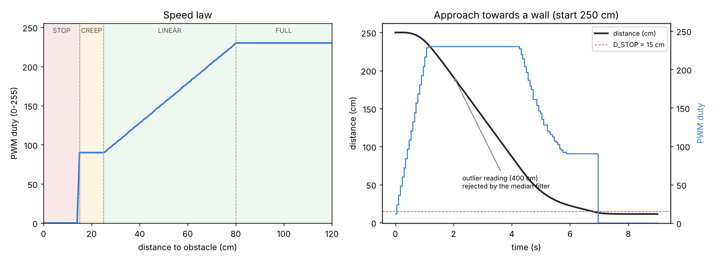
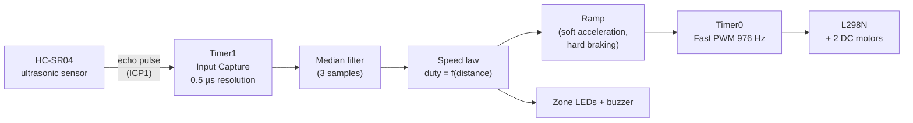

# Régulation de la vitesse d'un véhicule — ATmega328P

Embedded systems project (**IFRI — Université d'Abomey-Calavi**): obstacle-based speed control. A two-wheel vehicle adapts its speed to the distance to the obstacle in front of it. It drives at full speed when the way is clear, slows down progressively as it gets closer, and stops before the obstacle.

The firmware is written in **register-level C for the ATmega328P** (no Arduino library). It uses the timers directly: Timer1 *Input Capture* measures the ultrasonic echo, and Timer0 drives the motors with *Fast PWM*.



## How it works



| Distance | Zone | Motor duty | Indicators |
| --- | --- | --- | --- |
| < 15 cm | **STOP** | 0 (immediate) | red LED + buzzer |
| 15 – 25 cm | **CREEP** | 90 / 255 | yellow LED |
| 25 – 80 cm | **LINEAR** | 90 → 230, proportional to distance | green LED |
| > 80 cm / no echo | **FULL** | 230 / 255 | green LED |

Design choices:

- **Non-blocking measurement:** the echo width is captured in hardware by ICP1, with the noise canceler enabled. The ISR alternates between rising and falling edges.
- **Median of 3** rejects isolated wrong readings, such as a lost echo or a reflection. The simulation injects a 400 cm outlier at t = 2 s, and the robot does not react to it.
- **Asymmetric ramp:** acceleration is limited to +12 per period, while braking is allowed −60 per period and stopping is immediate.
- **Duty capped at 230** to keep a margin on the L298N, and a creep duty that is just high enough to beat the motors' dead band.
- **Thresholds in one place:** every threshold is in [`firmware/config.h`](firmware/config.h), and the simulation reads them from there too.

## Hardware & wiring

| Function | ATmega328P | Arduino Uno |
| --- | --- | --- |
| HC-SR04 TRIG | PB1 | D9 |
| HC-SR04 ECHO | PB0 / **ICP1** | D8 |
| L298N ENA (left motor PWM) | PD6 / **OC0A** | D6 |
| L298N ENB (right motor PWM) | PD5 / **OC0B** | D5 |
| L298N IN1, IN2 | PD2, PD3 | D2, D3 |
| L298N IN3, IN4 | PD4, PD7 | D4, D7 |
| LED green / yellow / red (220 Ω) | PC0 / PC1 / PC2 | A0 / A1 / A2 |
| Buzzer | PB2 | D10 |
| UART debug (9600 8N1) | PD1 / TXD | D1 |

Power the motors from the L298N supply (e.g. 2 × 18650 cells). Remove the ENA/ENB jumpers so the PWM pins drive the enables, and connect all grounds together.

## Build & flash

Requirements: `avr-gcc`, `avr-libc`, `avrdude` (on Windows, the AVR toolchain shipped with the Arduino IDE or Microchip Studio works).

```bash
cd firmware
make          # obstacle.hex  (≈ 2.6 KB flash, 95 B RAM)
make flash PORT=/dev/ttyACM0      # or PORT=COM3 on Windows
```

Serial monitor at 9600 baud:

```
d= 142 cm  duty=230
d=  63 cm  duty=186
d=  21 cm  duty= 90
d=  13 cm  duty=  0
```

## Simulation

`sim/simulate.py` re-implements the control loop on a robot model with motor inertia, a dead band and sensor noise, then plots the run:

```bash
pip install matplotlib
python sim/simulate.py
```

Starting 250 cm from a wall, the robot accelerates to full speed, slows down from 80 cm and stops at about 11 cm, without overshooting into the obstacle.

## Structure

```
firmware/main.c      UART, Timer1 ICP sonar, Timer0 PWM, speed law, ramp
firmware/config.h    thresholds, timings, pin map
firmware/Makefile    avr-gcc build + avrdude upload
sim/simulate.py      closed-loop simulation -> docs/simulation.png
```

---
**Author:** Maël Alain Bradley AZAÏNON — Embedded Systems & IoT, IFRI
